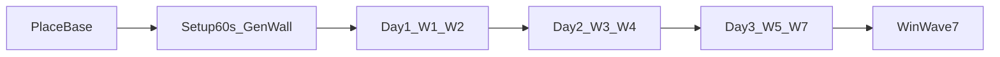

# GameLoop curve — เฟสแมตช์ · คลื่น · อ้าง pack JSON

(ความจริงตัวเลข = pack JSON) (`data/pack/`). เอกสารนี้ = คาดเดา timeline + threat สำหรับออกแบบ  
อย่าคัดลอกทั้ง `weapons.json` มาไว้ที่นี่ — อัปเมื่อบาลานซ์เปลี่ยน

## Hub นอก repo (กราฟ / เขียนยาว)

- Google Doc (เรื่องราว + แปะกราฟจาก Sheet):  
  https://docs.google.com/document/d/143kRF3GL2rUaVlI8EGQ4Z8XtC1Hr-DQwRnmXs0lHbgE/edit?hl=th  
- แนะนำคู่: (Google Sheet) แกน X = คลื่นหรือนาที · Y = จำนวนศัตรู / threat score → Insert chart เข้า Doc  
- Doc (ไม่ sync) กับ JSON อัตโนมัติ — เปลี่ยน pack แล้วอัปตารางใน Sheet/Doc ด้วยมือ

## อ้างอิง pack (แหล่งความจริง)

| หัวข้อ | ไฟล์ |
|--------|------|
| setup / countdown / นับศัตรู / HP ผู้เล่น | `data/pack/rules.json` |
| ความยาววัน (5 นาที = 1 วัน) | `data/pack/day.json` → `dayLengthSec` |
| องค์ประกอบคลื่น | `data/pack/units.json` → `waveComposition` / `waveTable` |
| Gen interval บนฐาน | `data/pack/blocks.json` → `BASE_CORE_3X3.generatorList` |
| กระสุนไกล vs unit กดยิง | `weapons.json` → `maxDistancePath` / `aiFireRangePath` |
| กระสุน vs เกราะฐาน | `damage_matrix.json` → `BULLET.DEFAULT` |

ค่าล็อกปัจจุบัน (อ่านจาก pack ตอนเขียนเอกสาร):

- `dayLengthSec` = (300) → แมตช์เป้า ~(900 s (15 นาที) = 3 วัน)
- `setupPhaseDurationSec` = (60) (หลังวางฐาน)
- `waveCountdownSec` = (20) (ระหว่างคลื่น; countdown ไม่รอเคลียร์หมด)
- `enemiesPerWaveBase` = (3), `enemiesPerWaveScale` = (1)  
  → นับโดยประมาณ `3 + (waveIndex - 1)` = (3…9) ในคลื่น 1…7
- `targetWaveToWin` = (7)
- Base Gen: WOOD (30s) · STONE (45s) · IRON (90s)

## Timeline ผู้เล่น (คาดเดา)

| ช่วงจริง (โดยประมาณ) | วันเกม | ผู้เล่นทำอะไร | Enemy |
|----------------------|--------|----------------|--------|
| 0 → วางฐาน | — | PLACE Base | ยังไม่สปอว์นคลื่น |
| +0–60s | เช้าวัน 1 | Gen / กำแพงบาง / craft เร่ง | setup countdown |
| ~1–5 นาที | วัน 1 | ป้อมแรก · Gen ไม้/หิน | W1–W2 grunt |
| ~5–10 นาที | วัน 2 | ขยายกำแพง · ป้อมเพิ่ม · Gen เหล็ก | W3–W4 mix |
| ~10–15 นาที | วัน 3 | ป้องกันหนัก | W5–W7 → บอส · ชนะ |

หมายเหตุ: countdown 20s เดินต่อเนื่องหลังแต่ละคลื่น — เวลาสู้จริงสั้น/ยาวตามเคลียร์ ไม่ล็อกตายตัวในสูตร spawn

## ตารางคลื่น (คาดเดา threat)

สูตรนับ: `count ≈ base + (w-1)*scale`  
Threat คร่าวๆ: `threat ≈ count × weightMix` (1.0 = grunt-only · สูงขึ้นเมื่อมี sniper/boss)

| Wave | t คร่าวๆ หลังวางฐาน* | count≈ | mix (จาก waveComposition) | threat≈ | ผู้เล่นเป้าสั้นๆ |
|------|----------------------|--------|---------------------------|---------|------------------|
| 1 | ~60s | 3 | GRUNT | 3 | Gen + กำแพงบาง |
| 2 | ~60+20+fight | 4 | GRUNT | 4 | ป้อม M1911/SMG |
| 3 | … | 5 | GRUNT+SNIPER | ~6 | อย่าเปิดหลัง |
| 4 | … | 6 | GRUNT+MEDIC+COWARD | ~7 | กด medic ก่อน |
| 5 | … | 7 | CMD+VANGUARD+… | ~9 | โฟกัสลีดเดอร์ |
| 6 | … | 8 | ENGINEER+SKIRMISH+HEAVY | ~11 | ป้อม 50Cal / เลเซอร์ |
| 7 | ~ใกล้ 15 นาที | 9 | BOSS+GRUNT+SKIRMISH | ~14 | โฟกัสบอส → ชนะ |

\*เวลาจริงของแต่ละคลื่น = setup/ระหว่างคลื่น + เวลาฆ่า — ใช้ Sheet ปรับคอลัมน์ “นาทีจริง” หลังเพลย์เทส

Sheet starter (คัดลอกไป Google Sheet)

แถวหัว:

`wave | count | mix | threat | minute_real | player_goal | json_ref`

ตัวอย่างแถว 1:

`1 | 3 | GRUNT | 3 | 1.0 | Gen+wall | rules+archetypes`

แล้ว Insert → Chart → Line (X=wave หรือ minute_real, Y=threat) → คัดลอกเข้า Google Doc

## ระยะยิง (อ้างสั้น — รายละเอียดใน weapons.json)

| ชั้น | ฟิลด์ | ความหมาย |
|------|--------|----------|
| กระสุนไกลสุด | `maxDistancePath` | โปรเจกไทล์หมดระยะ |
| Unit กดยิง | `aiFireRangePath` | บอท/สเตจ FIRE (คืนอาจ × night mul) |
| ป้อม/ฐานหันหา | `detectRadius` บนบล็อก | ต้อง ≥ แบนด์ยิงศัตรูทั่วไป |

ตัวอย่าง: SMG `aiFireRangePath` 0.75 Path · ฐาน/50Cal detect ~1178 px (~1.15 Path)

## เมื่อไหร่อัปเอกสารนี้

- เปลี่ยน `rules.json` / `day.json` / `waveComposition`
- เพลย์เทสแล้วนาทีจริงเพี้ยนจากตาราง
- ล็อก band ระยะใหม่ใน AskKeep
